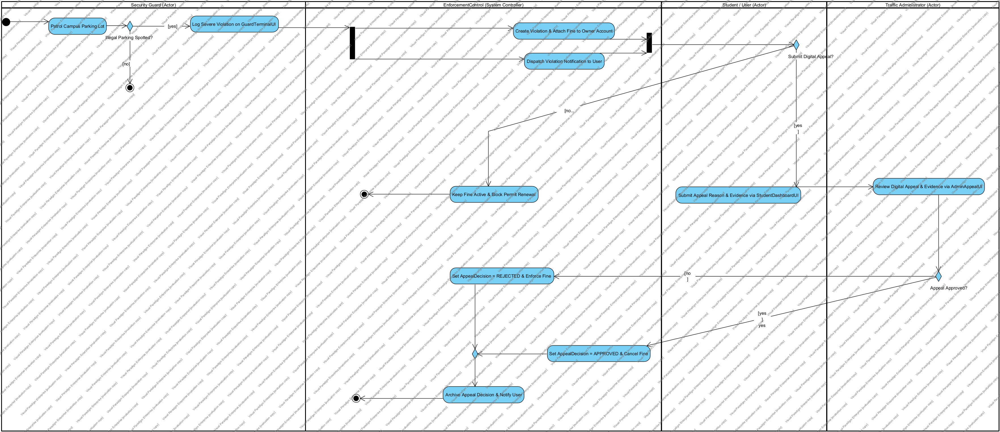
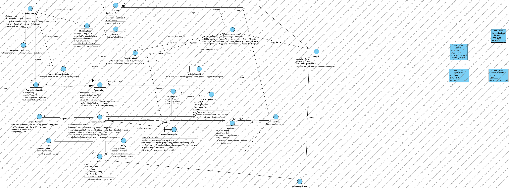
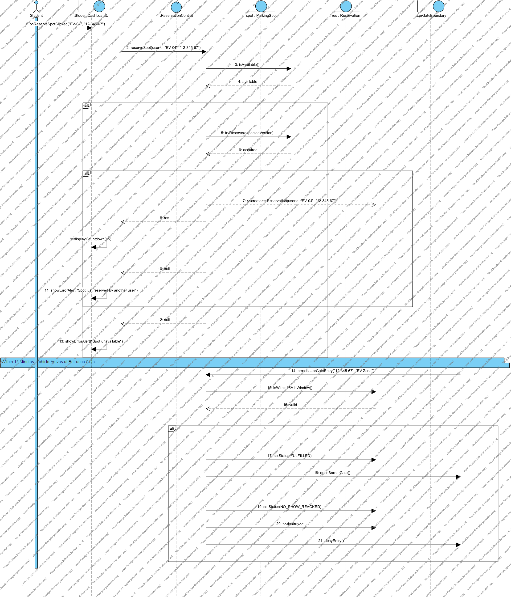
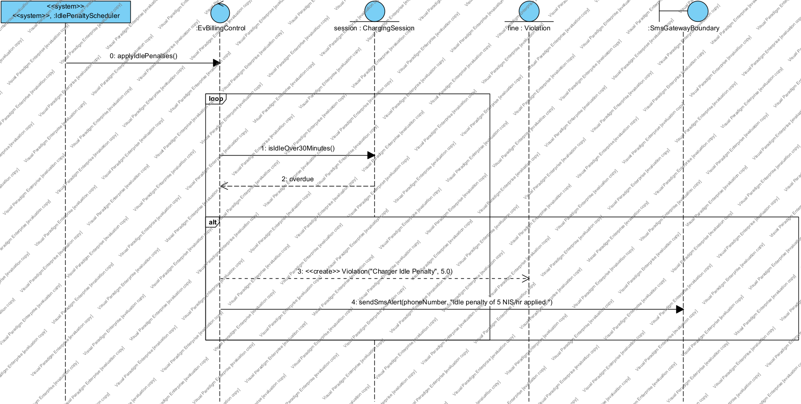

# System Architecture & Object-Oriented Design (`Ex4_SmartParking_Design`)

**Course:** 61756 Software Engineering Methods (Academic Year 2026-2027)
**Institution:** ORT Braude College of Engineering | Department of Software Engineering
**Domain:** Smart Campus Parking, LPR, and EV Network (Continued from Exercise 1)

---

## 1. Engineering Team Details

| Role | Full Name | Student ID | Braude Academic Email |
| :--- | :--- | :--- | :--- |
| **Student A (Role A)** | `[Enter Student A Full Name]` | `[Enter ID]` | `[studentA@e.braude.ac.il]` |
| **Student B (Role B)** | `[Enter Student B Full Name]` | `[Enter ID]` | `[studentB@e.braude.ac.il]` |

* **Group Number:** `G[XX]`
* **GitHub Repository URL:** `https://github.com/[Username]/Ex4_SmartParking_Design`

---

## 2. Step 1: Business Process Modeling — Activity Diagram (`Visual Paradigm`)

* **PlantUML Source:** [`diagrams/activity_appeal.puml`](diagrams/activity_appeal.puml)
* **Visual Paradigm Model:** [`SystemModel_Ex4.vpp`](SystemModel_Ex4.vpp)
* **Partitions / Swimlanes:** Separates external **Actors** (`Security Guard`, `Student / User`, `Traffic Administrator`) from the internal **System Controller** (`EnforcementControl`), using `initial node`, `fork`/`join` (AND), `decision` (XOR) with explicit `[guards]`, `merge` (OR), and `activity final node`.



---

## 3. Step 2: Structural Modeling — ECB Class Diagram (`PlantUML` -> `Visual Paradigm`)

Following the **ECB (Entity-Control-Boundary)** architectural pattern:

| ECB Stereotype | Classes in System | Architectural Responsibility |
| :--- | :--- | :--- |
| **`<<boundary>>`** | `StudentDashboardUI`, `GuardTerminalUI`, `AdminAppealUI`, `LprGateBoundary`, `PaymentGatewayBoundary`, `SmsGatewayBoundary` | Interfaces with external Actors and external hardware/payment/SMS systems. Communicates ONLY with `<<control>>` classes. |
| **`<<control>>`** | `ReservationControl`, `EvBillingControl`, `EnforcementControl` | Multiple specialized controllers orchestrating business rules, timers, concurrency checks, and workflows. |
| **`<<entity>>`** | `User` (`Student`, `Faculty`, `SecurityGuard`, `TrafficAdministrator`), `GuestPass`, `Vehicle`, `ParkingZone`, `ParkingSpot`, `Reservation`, `PaymentAuthorization`, `ChargingSession`, `Violation`, `Appeal` + 4 UML `enum`s | Passive domain data classes storing persistent business state and domain helper methods. |

* **PlantUML Source:** [`diagrams/class_diagram_ecb.puml`](diagrams/class_diagram_ecb.puml)
* **Visual Paradigm Model:** [`SystemModel_Ex4.vpp`](SystemModel_Ex4.vpp)



---

## 4. Step 3: Behavioral Modeling — ECB Sequence Diagrams (`PlantUML` -> `Visual Paradigm`)

### 4.1 Sequence Diagram 1: Spot Reservation, LPR Gate Entry & No-Show Destruction
* **PlantUML Source:** [`diagrams/sequence_reservation_ecb.puml`](diagrams/sequence_reservation_ecb.puml)



### 4.2 Sequence Diagram 2: EV Charging 30-Minute Idle Penalty (`loop` & `<<create>>`)
* **PlantUML Source:** [`diagrams/sequence_idle_penalty_ecb.puml`](diagrams/sequence_idle_penalty_ecb.puml)



---

## 5. Independent AI Prompt & Architectural Design Critique (Part 4)

```text
Please review our UML diagrams like a software architect would.
I attached SYSTEM_STORY.md, class_diagram_ecb.puml and sequence_reservation_ecb.puml.

Check our design against the two edge cases in Section 3 of the story:

Edge case A - two students press Reserve on the last free spot in the Student Zone at the exact same time.
Does our version field and tryReserve(expectedVersion) on ParkingSpot really make sure only one of them gets the spot? How should tryReserve work in the database, what isolation level do we need, can there be a deadlock, and what should the student who lost see? Also check if the sequence diagram shows both cases (acquired true and false).

Edge case B - a driver unplugs the EV cable at minute 29 but leaves the car in the spot.
Did we separate isPluggedIn from isPhysicallyOccupied correctly, so the 30 minute idle penalty still happens? What should happen if the parking sensor breaks?

Also please check:
- that every message in the sequence diagram has a matching method (same name and parameters) in the class diagram
- that we update the spot status and the user's noShowWarnings after a No-Show
- what happens to the PaymentAuthorization when we destroy a Reservation (it's a composition)

Give us the answer as a table: problem, how serious it is, which diagram/class, how to fix it.
Then show only the PlantUML lines we need to change.
```

* **Improvement 1 Applied (Race Condition):** Added `version: int` and `tryReserve(expectedVersion: int): boolean` on `ParkingSpot` (and nested `alt acquired == true/false` in Sequence Diagram 1) to prevent simultaneous double-booking.
* **Improvement 2 Applied (EV Physical Occupancy):** Separated `isPluggedIn` from `isPhysicallyOccupied` on `ChargingSession` so unplugging the cable at minute 29 without moving the car still triggers the 30-minute Charger Idle Penalty.
* **Improvement 3 Applied (No-Show Warnings):** Updated `noShowWarnings` on `User` after a No-Show and ensured `PaymentAuthorization` is destroyed when the associated `Reservation` is destroyed (composition).

---

## 6. License
Distributed under the **ORT Braude College Academic License** (61756 Software Engineering Methods, 2026-2027).
